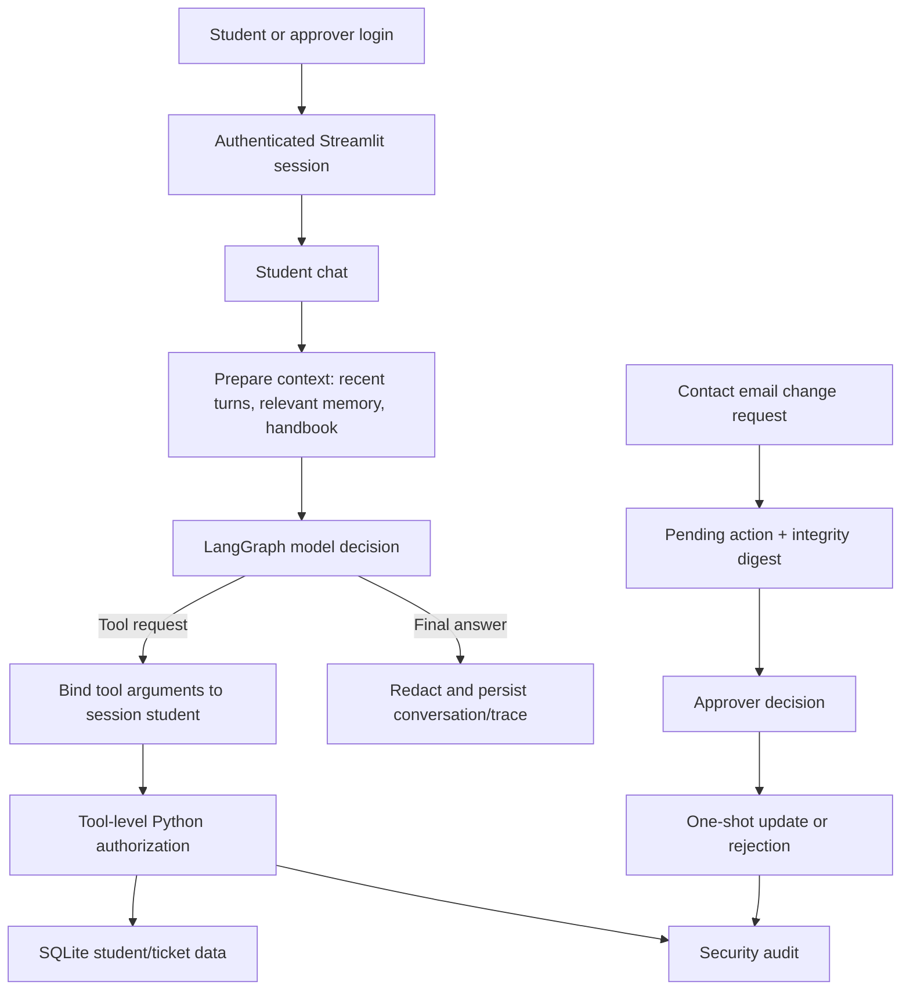

# Intelligent Student Support Agent — Assignment 2

This repository extends the Assignment 1 student support agent. It keeps the Streamlit chat, LangGraph workflow, fee and scholarship tools, support tickets, handbook retrieval, conversation history, long-term memory, tracing, and the Assignment 1 deterministic evaluation. Assignment 2 adds demo authentication, Python-enforced student data authorization, an approval workflow for contact email changes, persistent security auditing, and credential redaction before persistence.

All records and accounts are fictional. This project is a classroom demonstration, not a production student information system.

> **Keep the runtime handbook:** `rag/sample_handbook.md` is read by the application to build policy retrieval. It is an app data file, not duplicate documentation. Keep it even if you remove the other Markdown guides.

## 1. What you need

- Windows, macOS, or Linux
- Python 3.12 (recommended for this dependency set)
- Internet access for package installation, first-time Hugging Face embedding download, and Groq chat calls
- A Groq API key for the model-backed chat experience

The login, local SQLite security workflow, and offline tests do not use the model API. Chat responses do.

## 2. Install and configure

### Windows PowerShell

From the repository directory:

```powershell
py -3.12 -m venv .venv
.\.venv\Scripts\Activate.ps1
python -m pip install --upgrade pip
python -m pip install -r requirements.txt
if (-not (Test-Path .env)) { Copy-Item .env.example .env }
```

Open `.env` and set `GROQ_API_KEY` to your own key. Keep `.env` private; it is excluded from Git. Do not paste the key into chat or commit it.

### macOS or Linux

```bash
python3.12 -m venv .venv
source .venv/bin/activate
python -m pip install --upgrade pip
python -m pip install -r requirements.txt
cp -n .env.example .env
```

Then set `GROQ_API_KEY` in `.env`.

### Configuration

| Variable | Default | Purpose |
|---|---|---|
| `GROQ_API_KEY` | unset | Required for chat inference |
| `STUDENT_AGENT_PROVIDER` | `groq` | This version supports Groq |
| `STUDENT_AGENT_MODEL` | `openai/gpt-oss-20b` | Chat model name; use one supported by your Groq account |
| `STUDENT_AGENT_DB` | `student_support.sqlite3` | SQLite database path |
| `STUDENT_AGENT_POLICY` | `rag/sample_handbook.md` | Markdown policy source |
| `STUDENT_AGENT_INDEX_DIR` | `rag/index` | Local FAISS index directory |
| `STUDENT_AGENT_EMBEDDING_MODEL` | `sentence-transformers/all-MiniLM-L6-v2` | Local embedding model |
| `STUDENT_AGENT_TRACE_DIR` | `reports/traces` | Operational trace output directory |

The first index build downloads the embedding model and can take a few minutes. Later runs reuse the local model and FAISS index. The database and generated index are local demo data.

## 3. Start the application

```powershell
python -m database.seed
streamlit run app.py
```

Open the URL printed by Streamlit, usually `http://localhost:8501`. The app also initializes/seeds the database at startup. `database.seed` inserts only missing fictional students, so it is safe to rerun.

If your virtual environment refers to a Python installation that has been removed, create a fresh environment using the commands above. Do not try to repair or reuse a broken venv.

## 4. Sign in

The login page lists the demo accounts. The current fictional credentials are:

| Username | Role | Password |
|---|---|---|
| `asha` | Student (`STU1001`) | `Asha-Demo-2026!` |
| `kabir` | Student (`STU1002`) | `Kabir-Demo-2026!` |
| `mira` | Student (`STU1003`) | `Mira-Demo-2026!` |
| `approver` | Approver | `Approve-Demo-2026!` |

These source-defined credentials are intentionally convenient for a local assignment. Password verification uses PBKDF2-HMAC, but the accounts, fixed demo salt, and local session flow are **not production authentication**. Never reuse these passwords. A production system should use institutional SSO and managed credentials.

The seed records are fictional. Asha (`STU1001`) has a partially paid fee balance of 70,000 and a scholarship application under review. Kabir (`STU1002`) has paid fees and an approved scholarship. Mira (`STU1003`) has unpaid fees and no scholarship application. Use these expected results to explain the deterministic record tools during a viva.

## 5. Demonstrate the features


### A. Existing student support

Sign in as Asha and try:

1. “What is my fee status?”
2. “What is my scholarship status?”
3. “How long can a fee receipt take to appear?”
4. “Create a support request: my fee receipt has not appeared after payment.”
5. Ask about the returned ticket ID to check its status.

The chat answer, tool result, and policy evidence are shown in the conversation or the **Run trace and policy evidence** expander.

For a clear handbook demonstration, ask: “The payment portal failed on the due date. Can I pay next working day?” The fictional handbook says to keep an error reference and contact Finance Support; a verified outage or non-working day may be resolved by the next working day, while a late-fee waiver is not guaranteed. The retrieved passage should be cited by its `handbook-*` chunk ID. Ask “What GPA guarantees a scholarship?” to show a limitation: this sample handbook sets no GPA threshold and does not guarantee eligibility.

### B. Memory and credential filtering

In the sidebar, save a harmless preference such as “I prefer concise explanations.” Show it in the memory list, then delete it. Long-term memory accepts concise stable study context/preferences and rejects common credential patterns.

The app redacts common password, OTP, and API-key patterns before conversation and trace persistence. Detection is pattern based and cannot catch every possible secret. For the demo, use only an obviously fictional placeholder, never a real credential.

To show cross-session memory, save “I prefer concise explanations,” start a new conversation session, and ask “What communication preference did I save?” Then delete the memory using its sidebar control. This illustrates that session history and long-term memory are separate.

### C. Approval workflow

1. As a student, open **Sensitive action: request contact email change**.
2. Enter a fictional email and submit. Note the action ID and pending status. The student record remains unchanged while pending.
3. Sign out and sign in as `approver`.
4. Review the proposed change, then approve it. The change executes once.
5. Submit a second fictional change and reject it. The underlying record remains unchanged.
6. A stale or replayed decision is denied.

### D. Authorization and audit

Every private-data tool checks the authenticated principal in Python, including direct tool invocation. The graph also replaces model-supplied student IDs with the signed-in student's ID. A prompt asking for another student's data may therefore be scoped to the current student before reaching the tool; use the direct-tool test below to demonstrate an authorization denial reliably.

The **Security audit (evaluator)** expander shows persistent security events written to the app's configured SQLite database. Ordinary chat messages are not audit events. Tests use temporary databases for isolation, so their audit entries do not appear in the running app's audit panel.

For a persistent cross-student denial in the configured database, run this while the app's environment/dependencies are active:

```powershell
@'
from security.auth import authenticate
from security.authorization import authenticated_as
from tools.student_tools import check_fee_status

asha = authenticate("asha", "Asha-Demo-2026!")
with authenticated_as(asha):
    try:
        check_fee_status.invoke({"student_id": "STU1002"})
    except PermissionError:
        print("Cross-student request denied and audited.")
'@ | python -
```

Refresh the app and open the audit expander. Make sure `STUDENT_AGENT_DB` is the same in the app and command environment.


## 6. Run tests and evaluations

Run from the activated project environment:

```powershell
python -m pytest -q
python -m pytest tests/test_assignment2_security.py -q
python -m evaluation.run_evaluation
python -m evaluation.compare_assignments
```

- The test suite covers the original tool, graph, memory, RAG, and evaluation behavior plus Assignment 2 authorization, approval, rejection/replay, underlying database state, and credential filtering.
- `evaluation.run_evaluation` runs the retained 20-case deterministic Assignment 1 checks and writes `reports/evaluation.csv`. It does not call the LLM; its pass rate is not model accuracy.
- `evaluation.compare_assignments` runs offline Assignment 2 checks and writes `reports/assignment_comparison.json`. It measures local tool outcomes and latency, not model response quality or model token usage.
- Assignment 1 comparison values are marked unavailable when no clean baseline can be reproduced. Do not invent latency, task accuracy, token usage, or pass rates.
- Live graph runs append operational traces to `reports/traces/runs.jsonl`. Token usage appears only when the Groq response provides usage metadata.

If commands cannot run because packages are missing, confirm that the venv is activated and reinstall `requirements.txt`. If the project environment references a deleted Python version, recreate the venv. Do not report an unrun test as passing.

### Verification status for this workspace

Python syntax compilation and a standard-library SQLite smoke check passed for self-ownership, cross-student denial, approval, rejection without mutation, and persistent audit writes. The full pytest suite and comparison runner were not run successfully in the supplied environment: its virtual environment points to a removed Python 3.12 installation, while the available system Python lacks pytest and the app packages. No full-suite pass rate, model accuracy, measured latency comparison, or token total is claimed here.

## 7. Request flow and architecture



1. `app.py` authenticates the user and holds a trusted `Principal` in Streamlit session state. A student identity is never taken from chat as proof of identity.
2. `agent.graph.build_graph` prepares bounded context: up to six recent messages for the same student/session, relevant saved memories, and up to two relevant handbook sections for likely policy questions.
3. LangGraph asks the Groq chat model to answer or request one of the typed LangChain tools. A conditional route sends tool calls through an identity-scoping node and then `ToolNode`.
4. `tools.student_tools` calls the centralized policy in `security.authorization`. A direct tool call without a trusted student principal, or a request for another student's record, raises a generic permission error. Tool execution and permission decisions are audited.
5. The graph returns the answer, tool trace, retrieval evidence, latency, and provider token metadata when available. Conversation text and trace output are redacted before they are written.
6. A contact email update is stored as pending in SQLite. Only the approver role can decide it. Approval checks the action integrity and pending state, then updates the student row and consumes the action in one transaction. Rejection leaves the row unchanged. Conditional status changes prevent replay.

The application does not configure a LangGraph checkpoint. Conversation rows persist separately in SQLite but are not resumable graph checkpoints. Approval actions are durable in SQLite and do not execute on timeout or restart.

## 8. Repository map

```text
app.py                         Streamlit login, chat, memory, approval and audit UI
agent/graph.py                 LangGraph context, routing, tool loop and trace
agent/prompts.py               Model instructions and tool-use guidance
tools/student_tools.py         Fee, scholarship and support-ticket tools
security/auth.py               Fictional demo login and role principals
security/authorization.py      Trusted principal context and ownership policy
security/approvals.py          Durable email-change approval workflow
security/redaction.py          Credential-pattern redaction
database/db.py                 SQLite schema and connection helper
database/seed.py               Fictional student records
memory/policies.py             Long-term-memory allow/deny rules
memory/store.py                SQLite memory write/read/delete functions
rag/sample_handbook.md         Fictional policy source
rag/retrieval.py               Local embeddings and FAISS retrieval
observability/audit.py         Persistent security audit access
observability/tracing.py       Operational run traces, separate from audit
evaluation/                    Assignment 1 and Assignment 2 evaluation runners
tests/                         Original and Assignment 2 scenario tests
reports/                       Generated results and fictional sample audit rows
```

## 9. Storage, privacy, and observability

SQLite tables include:

- `students`: fictional fee, scholarship, programme, and contact profile data.
- `tickets`: support requests, scoped by student ID.
- `memories`: concise allowed stable facts, scoped by student ID.
- `conversation_messages`: redacted recent conversation history keyed by student and session.
- `pending_actions`: sensitive change proposal, integrity digest, approval status, and approver.
- `audit_events`: structured security decisions and execution outcomes.

Security audit events contain timestamps, event/correlation IDs, requester, action, minimized target, allow/deny decision, reason, approval status, execution status, and safe result summary where applicable. They do not intentionally include passwords, OTPs, keys, raw prompts, proposed email values, or full student records. `observability.audit.list_audit()` returns recent audit records. The current demo exposes an evaluator view in the app; production administrative access needs a separate authorization design.

Operational traces in `reports/traces/runs.jsonl` are distinct from security audit records. They include graph/tool/evidence details and may contain synthetic tool results. Protect those files and do not use this logging setup with real student records.

Memory accepts concise stable study context/preferences under an allow-list and rejects common credential, temporary, and sensitive patterns. The redaction and memory filters are best-effort regex rules, not a guarantee of perfect secret detection. No new long-term memory system was introduced.

## 10. Technical notes

### LangGraph and tools

- `AgentState` in `agent/graph.py` carries messages, authenticated student ID, session ID, question, retrieval results, iteration count, timing, and trace fields.
- The message reducer appends graph messages; the trace reducer merges trace dictionaries. `prepare_context`, `agent_decision`, `scope_tool_args`, `tools`, `record_tool_results`, and `finalize_and_trace` are the graph nodes. A conditional edge routes tool calls through the tool node or sends final answers to finalization.
- Nodes prepare context, invoke the model, scope tool arguments, execute `ToolNode`, record results, and finalize/persist the answer. The graph limits tool rounds (default four).
- `tools/student_tools.py` exposes fee status, scholarship status, ticket creation, and ticket status. Pydantic schemas validate IDs and ticket inputs. Parameterized SQL is used for database queries.
- Identity argument replacement is defense in depth. Actual authorization occurs in normal Python tool code and does not depend on prompt behavior.

In this project, a **node** is a work step, an **edge** is a transition, and a **conditional edge** chooses the next node based on state. A **tool** is a validated Python operation the model can request. The **model call** chooses a tool or writes a response; it does not execute Python itself. A **checkpoint** is a saved graph-state snapshot that can resume a thread. This app does not configure a LangGraph checkpoint; SQLite conversation rows and approval rows provide their own persistence.

### Handbook retrieval

`rag/retrieval.py` splits the Markdown source by `##` headings (no overlap), embeds sections using the local `sentence-transformers/all-MiniLM-L6-v2` model, and stores normalized vectors in a local CPU FAISS index. The source/model fingerprint determines whether to reuse or rebuild the index. Retrieval returns up to two relevant passages; squared L2 distance on normalized vectors is mapped to cosine similarity as `1 - distance / 2`, then filtered at the current 0.20 threshold. Results include chunk IDs and source names for citations. The sample handbook is fictional, not institutional policy. Do not load an untrusted FAISS index because the local loader enables deserialization for the app-managed index.

### Main implementation entry points

| Function | Location | Role |
|---|---|---|
| `get_chat_model()` | `config/settings.py` | Reads Groq settings, checks the API key, returns a zero-temperature chat client |
| `build_graph(...)`, `run_agent(...)` | `agent/graph.py` | Build the bounded graph and invoke it with authenticated identity context |
| `PolicyRetriever(...)`, `retrieve(...)` | `rag/retrieval.py` | Build/load the local vector index and retrieve cited passages |
| `authenticate(...)` | `security/auth.py` | Verify a demo login and return an immutable principal |
| `authorize_student(...)` | `security/authorization.py` | Enforce student ownership in trusted Python code |
| `request_email_change(...)`, `decide_action(...)` | `security/approvals.py` | Create and decide durable one-time sensitive actions |
| `audit(...)`, `list_audit(...)` | `observability/audit.py` | Persist and read structured security events |
| `classify_memory(...)` | `memory/policies.py` | Apply the stable-memory allow-list and sensitive-content exclusions |
| `save_memory(...)`, `retrieve_memories(...)`, `delete_memory(...)` | `memory/store.py` | Persist, retrieve, inspect, and delete student-scoped memories |

### Errors and bounded behavior

Pydantic validates tool inputs. SQLite access uses parameterized SQL and transaction rollback on exceptions. Missing records/tickets and denied access do not return protected records. Unsupported handbook questions should be answered with the limitation rather than an invented rule. The UI catches model/configuration errors and shows a safe retry message. The graph has a four-decision tool-call limit to avoid an unbounded loop. Offline evaluation exercises deterministic code and mocked/model-free scenarios; it does not measure Groq reliability or generated-answer accuracy.

### Dependencies and boundaries

LangGraph and LangChain implement orchestration and typed tool calls; `langchain-groq` provides hosted model inference; `langchain-community`, `langchain-huggingface`, `sentence-transformers`, and `faiss-cpu` support local retrieval; Streamlit provides the UI; SQLite provides local persistence; pytest runs tests. Dependency constraints are in `requirements.txt`.

## 11. Troubleshooting and reset

- **Login fails:** use the exact demo username/password shown in section 4; password case matters.
- **Chat says it cannot complete:** verify `GROQ_API_KEY`, configured model availability, internet access, and provider limits. The local security workflow can still be demonstrated without chat inference.
- **FAISS/embedding error:** activate the correct Python 3.12 environment, reinstall `requirements.txt`, and ensure first-run network access for the embedding model.
- **No token counts:** the provider did not return usage metadata for that response.
- **Audit panel is empty:** ordinary chat does not generate audit rows. Ask a question that actually invokes a private-data tool or perform an audited approval action. The pytest security fixtures use temporary databases and their rows are intentionally discarded. Ensure the app and shell use the same `STUDENT_AGENT_DB`.
- **Reset local demo records and audit:** stop Streamlit, then remove `student_support.sqlite3` intentionally. The app recreates fictional seed records on next start. This also deletes local approvals, conversations, memories, and audit history.


